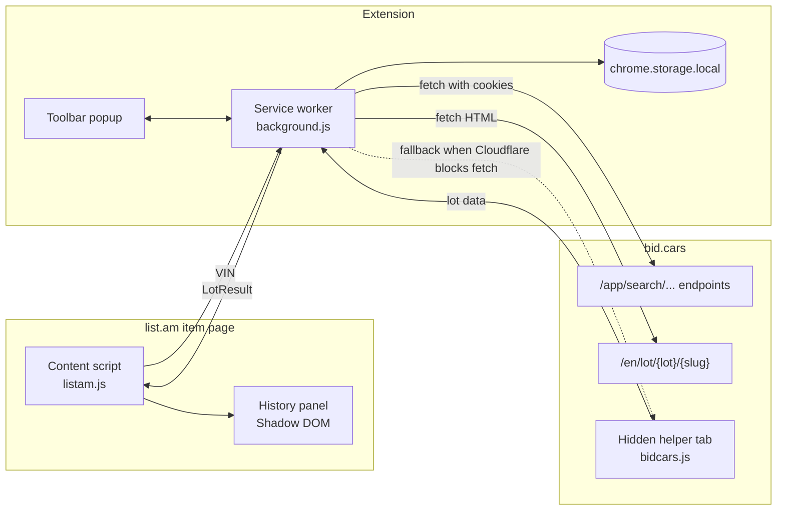

# 01 — Specification

## 1. Scope

### In scope (v1)

- Car listing pages on list.am in every language version:
  - `https://www.list.am/item/{id}` (Armenian)
  - `https://www.list.am/ru/item/{id}`
  - `https://www.list.am/en/item/{id}`
- Reading the VIN from the listing.
- Resolving the VIN to a bid.cars lot (active or archived).
- Showing the bid.cars photos and a short auction summary next to the listing gallery.
- Caching results so the same VIN is not looked up again on every page view.

### Out of scope (v1)

- Search result / category pages on list.am (badges in the list view could come later; see §9).
- Other history sources (Carfax, AutoAstat, bidfax, Copart/IAAI directly).
- Showing the final auction price (bid.cars hides it from anonymous users).
- Firefox / Safari.

## 2. Functional requirements

| ID | Requirement |
| --- | --- |
| FR-1 | On a list.am item page, the extension detects whether the listing has a VIN. |
| FR-2 | The VIN is read from the "VIN" attribute tile (see [05-dom-reference.md](05-dom-reference.md)), not from a fixed position or a long class path. |
| FR-3 | The VIN is normalized (trim, uppercase, remove spaces) and validated: 17 characters, `[A-HJ-NPR-Z0-9]` (no I, O or Q). An invalid VIN is reported in the panel but not looked up. |
| FR-4 | If there is no VIN, the extension does **not** change the page layout. Optionally it shows a small "No VIN in this listing" hint with a manual VIN input (setting, off by default). |
| FR-5 | For a valid VIN, the extension resolves the bid.cars lot using the strategy in [03-vin-to-lot-resolution.md](03-vin-to-lot-resolution.md). |
| FR-6 | While resolving, a history panel with a loading state is shown next to the listing gallery. |
| FR-7 | When a lot is found, the panel shows the bid.cars photo gallery (all photos, full size on click) and an auction summary: title, auction (Copart/IAAI), lot number, sale date, location, odometer, primary/secondary damage, sale document (title type), key, start code, and a link to the bid.cars lot page. |
| FR-8 | When the VIN has more than one auction record (the car was auctioned more than once), the most recent one is shown by default and the others are listed with links in the panel. |
| FR-9 | When nothing is found, the panel shows "No auction history found on bid.cars" plus a "Search manually" link to the bid.cars search URL for that VIN. |
| FR-10 | When bid.cars cannot be reached (Cloudflare challenge, network error, timeout), the panel shows the reason and a "Retry" button and an "Open bid.cars" link. |
| FR-11 | Results are cached in `chrome.storage.local`, keyed by VIN. Found results are kept 30 days, "not found" results 3 days, errors are not cached. |
| FR-12 | The toolbar popup shows the status for the current tab (VIN, found / not found / error), a "Re-check" button that ignores the cache, and a "Clear cache" button. |
| FR-13 | Odometer is shown in both miles and kilometers so it can be compared directly to the list.am mileage (which is in km). |
| FR-14 | Show a mileage warning when the list.am reading is more than 1,000 km below the auction reading after unit conversion. Also flag past damage recorded at auction when the listing says "not damaged". |

## 3. Non-functional requirements

| ID | Requirement |
| --- | --- |
| NFR-1 | The listing page stays usable while the lookup runs. The extension must never block or break list.am's own gallery, price block or contact buttons. |
| NFR-2 | A cached result renders in under 300 ms after the page is ready. An uncached lookup should take under 5 s on a normal connection. |
| NFR-3 | Extension styles must not leak into list.am, and list.am styles must not break the panel (render the panel in a Shadow DOM). |
| NFR-4 | No data leaves the browser other than requests to list.am and bid.cars. No analytics, no third-party servers. |
| NFR-5 | Lookups are throttled: at most 1 bid.cars lookup in flight per VIN, and no more than ~10 lookups per minute overall, so it looks like normal human browsing. |
| NFR-6 | Selector and endpoint constants live in one config module, so a site redesign means editing one file. |
| NFR-7 | When the DOM no longer matches (site redesign), fail quietly: no panel, one console warning, and an "unsupported page layout" status in the popup. |

## 4. Architecture

Manifest V3 extension with three parts:



### 4.1 Content script — `listam.js`

- Runs on `https://www.list.am/*item/*` at `document_idle`.
- Extracts the VIN (FR-2, FR-3) and the list.am photo URLs.
- Inserts the side-by-side layout and the history panel (see [04-ui-redesign.md](04-ui-redesign.md)).
- Sends `{type: "lookup", vin}` to the service worker and renders whatever comes back.
- Parses bid.cars lot HTML with `DOMParser` when the service worker forwards raw HTML
  (service workers do not have `DOMParser`).

### 4.2 Service worker — `background.js`

- Owns the cache and the lookup pipeline from [03-vin-to-lot-resolution.md](03-vin-to-lot-resolution.md).
- Makes the cross-origin requests to bid.cars (content scripts cannot, because of CORS;
  the extension's service worker can, thanks to `host_permissions`).
- Deduplicates concurrent lookups for the same VIN.
- Opens and closes the hidden helper tab for the fallback path.

### 4.3 bid.cars helper content script — `bidcars.js`

- Injected only into tabs the extension opened itself (via `chrome.scripting.executeScript`),
  never into tabs the user opened.
- Reads the lot data from the rendered lot page and sends it back.

### 4.4 Popup — `popup.html` / `popup.js`

- Status for the active tab, Re-check, Clear cache, settings (FR-4 toggle, panel default width).

## 5. Manifest (draft)

```json
{
  "manifest_version": 3,
  "name": "List.am VIN History",
  "version": "0.1.0",
  "description": "Shows bid.cars auction history and photos next to list.am car listings.",
  "permissions": ["storage", "scripting", "tabs", "offscreen"],
  "host_permissions": [
    "https://www.list.am/*",
    "https://bid.cars/*",
    "https://mercury.bid.cars/*",
    "https://images.bid.cars/*"
  ],
  "background": { "service_worker": "background.js", "type": "module" },
  "content_scripts": [
    {
      "matches": [
        "https://www.list.am/item/*",
        "https://www.list.am/*/item/*"
      ],
      "js": ["listam.js"],
      "run_at": "document_idle"
    }
  ],
  "action": { "default_popup": "popup.html" }
}
```

## 6. Data model

```ts
type LookupStatus = "found" | "not_found" | "invalid_vin" | "blocked" | "error";

interface LotResult {
  status: LookupStatus;
  vin: string;
  checkedAt: number;            // epoch ms
  source: "vin-lot" | "search-api" | "archived-api" | "lot-page" | "helper-tab";
  lot?: {
    id: string;                 // "1-61989692"  (0- = IAAI, 1- = Copart)
    url: string;                // https://bid.cars/en/lot/1-61989692/2020-Mazda-6-JM1GL1VM3L1522160
    title: string;              // "2020 Mazda 6, Touring"
    auction: "Copart" | "IAAI";
    archived: boolean;
    saleDate?: string;          // "2022-11-21"
    location?: string;          // "Trenton (NJ)"
    odometerMi?: number;        // 42090
    primaryDamage?: string;     // "Front end"
    secondaryDamage?: string;   // "Rear"
    saleDocument?: string;      // "Cert of title-salvage (NJ)"
    key?: string;               // "Missing"
    startCode?: string;
    color?: string;
    images: string[];           // full-size photo URLs, in gallery order
  };
  otherLots?: { id: string; url: string; saleDate?: string; auction?: string }[];
  error?: string;               // human-readable reason for blocked / error
}
```

Cache entry: `chrome.storage.local["vin:" + vin] = LotResult`.

## 7. Permissions rationale

| Permission | Why |
| --- | --- |
| `storage` | Cache of lookup results and settings. |
| `scripting` | Inject `bidcars.js` into the helper tab. |
| `tabs` | Open/close the hidden helper tab and watch its URL change after the search redirect. |
| `offscreen` | An offscreen document with `DOMParser`, used to parse bid.cars lot HTML fetched by the service worker. |
| `host_permissions: list.am` | Run the content script. |
| `host_permissions: bid.cars, mercury.bid.cars, images.bid.cars` | Cross-origin fetches from the service worker, with the user's bid.cars cookies (needed to pass Cloudflare). |

## 8. Risks

| Risk | Impact | Mitigation |
| --- | --- | --- |
| bid.cars is behind Cloudflare bot protection (confirmed: plain HTTP requests get `403 Just a moment...`). | Service-worker fetches may be blocked. | Requests carry the user's cookies (`cf_clearance`) and real browser user agent. If still blocked, use the hidden helper tab, which is a normal browser navigation. See [03](03-vin-to-lot-resolution.md#cloudflare). |
| bid.cars internal `/app/...` endpoints are undocumented. | They can change without notice. | Layered strategy: endpoint, then HTML lot page, then helper tab. All URLs in one config file. |
| list.am or bid.cars redesign. | Selectors stop matching. | Use semantic anchors (VIN icon, `data-testid`, JSON-LD) instead of class chains; fail quietly (NFR-7). |
| `mercury.bid.cars` photos are behind the same Cloudflare check (confirmed: `403 Just a moment...`), and Brave blocks third-party cookies, so `` tags on list.am may be challenged. | Photos do not load inside list.am. | Fallback: the service worker fetches the photo with the user's bid.cars cookies and the panel shows it as a `data:` URL. If that also fails, the panel asks the user to open bid.cars once and reload photos. |
| bid.cars terms of use. | Automated access may be against their terms. | Personal use, one lookup per opened listing, caching, throttling (NFR-5). No bulk scraping. |

## 9. Possible later versions

- v1.1: VIN badges ("auction history: yes/no") on list.am search result pages, using cached results only.
- v1.2: Photo comparison mode (pick one photo from each side and show them overlaid or in a slider).
- v1.3: Additional sources when bid.cars has nothing (e.g. bidfax, autoastat).
